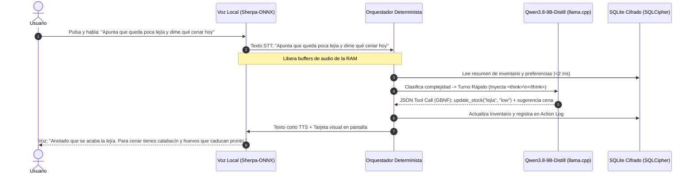
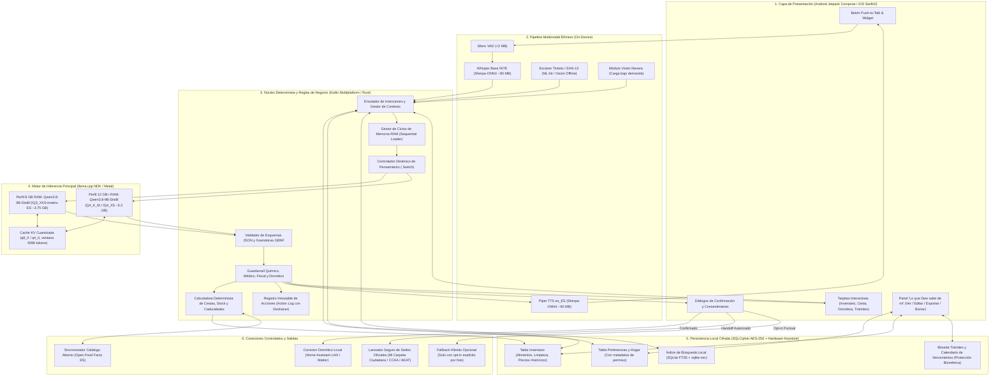
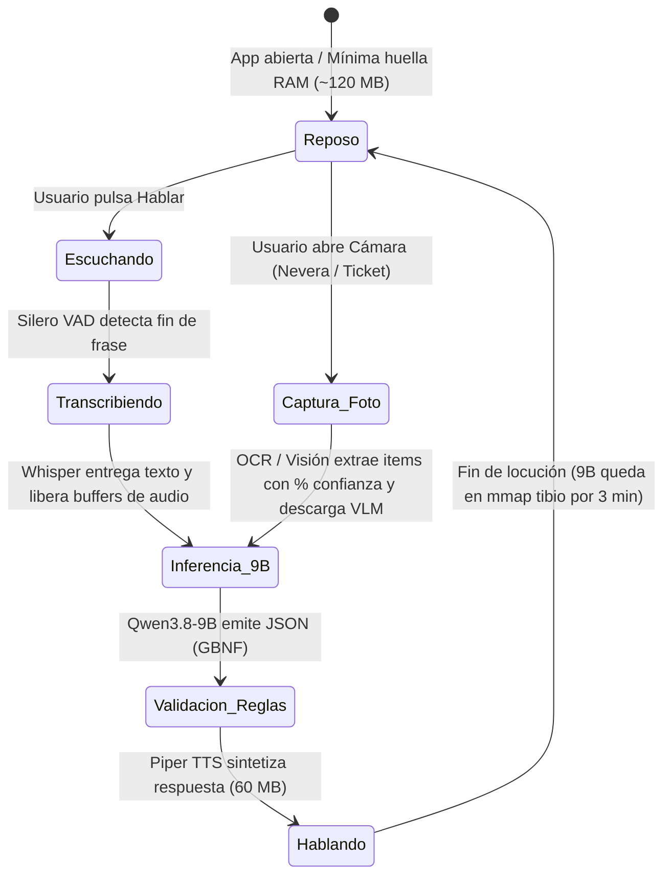

# Dew — Documento de Producto, Arquitectura de Software e IA (Especificación Técnica v1.0)

> **Visión ejecutiva:** **Dew** es un asistente doméstico personal, *local-first*, ligero en costes operativos y centrado en la privacidad para hogares en España. Aprende con permiso explícito, gestiona alimentación, nevera/despensa, productos de limpieza, domótica y preparación de trámites españoles, ejecutando como motor principal una arquitectura de doble nivel sobre **`empero-ai/Qwen3.8-9B-Distill`** (Apache 2.0) directamente en el teléfono móvil.

---

## Índice

1. [Resumen del Producto](#1-resumen-del-producto)
2. [Supuestos Validados, Hipótesis y Matriz de Riesgos](#2-supuestos-validados-hipótesis-y-matriz-de-riesgos)
3. [Alcance del MVP (Incluido vs. Excluido)](#3-alcance-del-mvp-incluido-vs-excluido)
4. [Flujos Principales y Diseño de Interacción por Voz (VUI)](#4-flujos-principales-y-diseño-de-interacción-por-voz-vui)
5. [Arquitectura del Sistema (Hexagonal Local-First)](#5-arquitectura-del-sistema-hexagonal-local-first)
6. [Motor de IA Local: Estrategia de Doble Versión `Qwen3.8-9B-Distill`](#6-motor-de-ia-local-estrategia-de-doble-versión-qwen38-9b-distill)
7. [Pipeline de Voz, Visión y Gestión de Memoria RAM en Móviles](#7-pipeline-de-voz-visión-y-gestión-de-memoria-ram-en-móviles)
8. [Estrategia de Personalización y Memoria](#8-estrategia-de-personalización-y-memoria)
9. [Integraciones con Servicios Digitales en España](#9-integraciones-con-servicios-digitales-en-españa)
10. [Seguridad, Privacidad, Guardarraíles y Confianza](#10-seguridad-privacidad-guardarraíles-y-confianza)
11. [Plan de Desarrollo por Hitos y Criterios de Validación](#11-plan-de-desarrollo-por-hitos-y-criterios-de-validación)
12. [Estructura de Costes y Requisitos](#12-estructura-de-costes-y-requisitos)

---

## 1. Resumen del Producto

* **Usuario objetivo:** Hogares en España (personas que viven solas, parejas y familias) con teléfonos móviles de **8 GB de RAM en adelante** que desean delegar la organización cotidiana de la casa (comidas, inventario de nevera y limpieza, compras presupuestadas, domótica y recordatorio/preparación de trámites administrativos) sin exponer su intimidad a la nube ni pagar suscripciones costosas.
* **Problema principal:** La gestión doméstica está fragmentada en múltiples notas, listas y aplicaciones desconectadas. Los asistentes de voz clásicos dependen de la nube, son rígidos y carecen de contexto doméstico real; los chatbots genéricos olvidan las restricciones del hogar, alucinan datos y no pueden acoplarse con seguridad a acciones cotidianas.
* **Propuesta de valor:**
  * **100% Local-First y Offline para la rutina diaria:** El cerebro (`Qwen3.8-9B-Distill`), la voz (`Whisper` + `Piper`) y la base de datos (`SQLCipher`) viven en el dispositivo.
  * **Razonamiento de 9B parámetros en el bolsillo:** Gracias a la cuantización guiada por matriz de importancia (`imatrix`) y al control dinámico del bloque de pensamiento (`<think>`), ofrece respuestas instantáneas para comandos diarios y razonamiento profundo para planificación semanal y presupuestos.
  * **El modelo propone, el código determinista dispone:** Ninguna compra, acción domótica crítica ni trámite se ejecuta libremente por la IA sin validación de reglas de negocio y confirmación explícita del usuario.

---

## 2. Supuestos Validados, Hipótesis y Matriz de Riesgos

| Tipo | Descripción | Riesgo Principal | Mecanismo de Mitigación y Validación |
| :--- | :--- | :--- | :--- |
| **Hecho verificado (Modelo y Licencia)** | `empero-ai/Qwen3.8-9B-Distill` está construido sobre la arquitectura híbrida `Qwen/Qwen3.5-9B` (*Gated DeltaNet* + atención completa) bajo licencia **Apache 2.0**, permitiendo uso comercial, modificación y distribución de pesos cuantizados. | En móviles de 8 GB de RAM, el sistema Android reserva ~3,3–3,5 GB; un modelo mal empaquetado provocaría cierres por falta de memoria (*Low Memory Killer - LMKD*). | Uso de cuantización **`IQ3_XXS` con `imatrix` en español (~3,75 GB)**, caché KV cuantizada (`q8_0`/`q4_0`), carga por `mmap` sin `mlock` y descarga secuencial de módulos de voz/visión. |
| **Hecho verificado (Latencia CoT)** | `Qwen3.8-9B-Distill` abre por defecto un bloque `<think>...</think>` antes de responder. En una CPU/GPU móvil (8–15 tok/s), pensar 300 tokens bloquearía la voz durante 20–35 s. | Experiencia de voz inutilizable por latencia excesiva en comandos cortos. | **Inyección de cierre de pensamiento (`<think>\n</think>`)** en la plantilla del prompt para turnos rápidos (90% de los casos), habilitando `<think>` abierto solo en tareas de planificación (10%). |
| **Hecho verificado (Administración ES)** | No existe API pública abierta para pedir citas médicas en las 17 CCAA ni acceso libre sin certificado/apoderamiento a la AEAT o Mi Carpeta Ciudadana. | Intentar automatizar sedes electrónicas con bots/scraping es frágil, inseguro e incumple normativas. | Enfoque **Copiloto Preparador (Nivel 2)**: preparación local de documentación, recordatorios de vencimientos y lanzamiento de *Deep Links / Intents* hacia las apps oficiales (`Cl@ve`, `Mi Carpeta Ciudadana`, Salud Autonómica). |
| **Hipótesis crítica (Visión en nevera)** | Las fotos periódicas de la nevera contienen oclusiones (envases al fondo, táperes opacos, poca luz). | Frustración si el usuario debe corregir manualmente muchos productos mal identificados. | Combinar **3 vías de entrada**: (1) Escaneo rápido de ticket/código de barras al llegar de comprar, (2) Dictado rápido por voz al gastar algo, y (3) Foto periódica de nevera con marcador explícito de incertidumbre. |
| **Hipótesis crítica (Descarga inicial)** | El paquete de modelos ocupa **~3,9 GB** (versión 8 GB RAM) o **~5,3 GB** (versión 12 GB+ RAM). | Abandono durante la instalación si el usuario no puede usar la app hasta bajar 4 GB. | **Onboarding sin bloqueo**: la interfaz, el inventario por voz/texto ligero y el escáner de tickets funcionan desde el minuto 1 mientras el modelo 9B se descarga en segundo plano vía Wi-Fi con soporte de reanudación HTTP Range. |

---

## 3. Alcance del MVP (Incluido vs. Excluido)

### Funciones INCLUIDAS en el MVP (v1.0)
1. **Motor Dual `Qwen3.8-9B-Distill` autodetectado por hardware:**
   * Selección automática en el primer arranque entre el perfil **8 GB RAM (`IQ3_XXS-imatrix-ES`)** y el perfil **12 GB+ RAM (`Q4_K_M` / `IQ4_XS`)**.
   * Conmutador automático de pensamiento: **Modo Instantáneo** (`<think>\n</think>` pre-cerrado) para voz/acciones rápidas y **Modo Planificador** (`<think>` activo) para menús y presupuestos.
2. **Interacción por Voz y Texto 100% Local en Español:**
   * *Push-to-Talk* (pulsar para hablar) mediante `sherpa-onnx` (`Silero VAD` + `Whisper Base INT8` + `Piper TTS es_ES`).
   * Indicador visual y verbal honesto del estado de conexión (Modo Local Puro vs. Con Conectividad).
3. **Memoria Personal Estructurada con Consentimiento:**
   * Aprendizaje progresivo de comensales, alergias/intolerancias, alimentos evitados, horarios, actividad física y presupuesto.
   * Panel **«Lo que Dew sabe de ti»** con visualización clara, edición directa, exportación (`JSON`/`CSV`) y borrado total o granular.
4. **Nevera, Despensa, Limpieza y Compras:**
   * Inventario unificado de alimentación y consumibles de limpieza del hogar con estimación de agotamiento y caducidades.
   * Captura por **foto de nevera/despensa** (mostrando porcentaje de confianza y preguntando dudas), **OCR local de tickets de supermercado** y **lector de códigos de barras**.
   * Generación de **Cesta de Compra revisable** con coste estimado basado en tickets previos y catálogo abierto ([Open Food Facts España](https://es.openfoodfacts.org/)). Prohibida la compra automática sin confirmación.
   * **Guardarraíl de Seguridad Química determinista:** bloqueo estricto de cualquier sugerencia de mezcla de productos químicos (lejía + amoniaco, lejía + vinagre/ácidos, etc.).
5. **Control Domótico Local (Conector Estándar):**
   * Integración local por red Wi-Fi/LAN con **Home Assistant API** (WebSocket/REST) e intents del sistema, con validación de permisos, gestión de dispositivos desconectados y confirmación obligatoria para acciones sensibles.
6. **Copiloto de Trámites en España (Nivel 2 - Preparación y Handoff):**
   * Preparación de citas médicas, gestiones municipales/autonómicas y calendario/documentación de la Agencia Tributaria, culminando siempre en el traspaso controlado (*handoff*) a la aplicación o sede oficial para que el usuario firme o confirme con `Cl@ve` / Certificado.

### Funciones EXCLUIDAS del MVP (Pospuestas a Fase 2+)
* **Escucha activa continua 24/7 por palabra de activación (*Wake-word* en segundo plano):** Excluida del MVP para evitar consumo de batería en reposo y bloqueos de servicios en segundo plano de Android/iOS. Se usa botón flotante, widget de escritorio y acceso rápido.
* **Pago o envío automatizado de carritos en webs de supermercados (scraping transaccional):** Excluido por seguridad financiera y ausencia de APIs públicas abiertas en supermercados españoles; el usuario revisa la cesta y la usa en modo tienda o la transfiere a su canal autorizado.
* **Automatización intrusiva de formularios en Sedes Electrónicas (bots con certificados/Cl@ve):** Prohibido por diseño por motivos legales, de ciberseguridad y protección de datos.

---

## 4. Flujos Principales y Diseño de Interacción por Voz (VUI)

### Reglas de Oro del Diseño de Voz de Dew
1. **Brevedad oral, riqueza visual:** Las respuestas habladas nunca superan **2 frases (~20 palabras)**.Las listas de ingredientes, desgloses de precios en euros y pasos administrativos se muestran simultáneamente en tarjetas interactivas en pantalla.
2. **Transparencia de estado:** Si una consulta requiere red (p. ej. abrir la sede de la AEAT o consultar un producto nuevo en Open Food Facts) y el teléfono está sin cobertura, Dew informa al instante qué parte ha dejado preparada localmente y qué queda pendiente de conexión.
3. **Cero suposiciones silenciosas:** Dew nunca deduce ni guarda datos sensibles (salud, ingresos, miembros del hogar) sin formular antes una pregunta explícita de permiso.

### Diagrama de Secuencia: Flujo de Voz Rápida vs. Planificación Profunda en `Qwen3.8-9B-Distill`



---

## 5. Arquitectura del Sistema (Hexagonal Local-First)

El diseño separa de forma estricta la **Interfaz**, el **Núcleo Determinista de Reglas y Políticas**, el **Motor de IA Local**, el **Almacenamiento Cifrado** y los **Conectores Externos**.

### Diagrama General de Arquitectura



---

## 6. Motor de IA Local: Estrategia de Doble Versión `Qwen3.8-9B-Distill`

### 6.1. Ficha Técnica Verificada del Modelo Elegido
* **Repositorio base de pesos:** [`empero-ai/Qwen3.8-9B-Distill`](https://huggingface.co/empero-ai/Qwen3.8-9B-Distill) (destilación de razonamiento de parámetros completos sobre arquitectura híbrida `Qwen/Qwen3.5-9B`).
* **Licencia:** **Apache License 2.0** (software libre y open source aprobado por la OSI; permite uso comercial, empaquetado propio, recuantización y distribución gratuita sin regalías).
* **Arquitectura interna:** Híbrida (*Gated DeltaNet* de atención lineal combinada con capas de atención completa). Esta arquitectura reduce drásticamente el crecimiento de la memoria *KV-Cache* frente a un Transformer tradicional de 9B.

### 6.2. Los Dos Perfiles de Distribución en Dew

Al abrir la aplicación por primera vez, el módulo `HardwareProfiler` consulta `ActivityManager.MemoryInfo.totalMem` (en Android) o `ProcessInfo.processInfo.physicalMemory` (en iOS) y asigna automáticamente la variante óptima:

| Parámetro | **Edición Compacta 8 GB (`Dew-9B-Compact`)** | **Edición Estándar 12 GB+ (`Dew-9B-Pro`)** |
| :--- | :--- | :--- |
| **Teléfono objetivo** | Móviles con **8 GB de RAM** (Gama media y media-alta actual en España) | Móviles con **12 GB a 16+ GB de RAM** (Gama alta) |
| **Formato y Cuantización** | **GGUF `IQ3_XXS`** (3.06 bpw) con **Matriz de Importancia (`imatrix`) propia calibrada en español** | **GGUF `Q4_K_M` / `IQ4_XS`** (4.25–4.5 bpw) con `imatrix` en español |
| **Tamaño de descarga (Wi-Fi)** | **~3,75 GB** | **~5,10 – 5,55 GB** |
| **RAM consumida en ejecución (con KV 4k cuantizada)** | **~4,20 – 4,45 GB** (usando `mmap` paginable por el SO) | **~5,80 – 6,30 GB** |
| **Velocidad estimada (Generación)** | **8 – 14 tokens/s** | **12 – 22 tokens/s** |
| **Tiempo al primer token (TTFT en Modo Rápido)** | **0,6 – 1,2 segundos** (con *Prompt Caching* activo) | **0,4 – 0,8 segundos** (con *Prompt Caching* activo) |

### 6.3. Las 5 Optimizaciones Obligatorias para Ejecutar el 9B en 8 GB de RAM

1. **Matriz de Importancia (`imatrix`) calibrada con Corpus Doméstico Español:**
   * Antes de publicar el archivo `.gguf` de `IQ3_XXS`, ejecutamos `llama-imatrix` sobre un corpus propio de 1.000 ejemplos que incluye: castellano coloquial, vocabulario de alimentación y limpieza en España, tickets de Mercadona/Carrefour/Dia/Eroski y esquemas JSON de las herramientas de Dew.
   * Esto garantiza que los pesos responsables del idioma español y de la sintaxis JSON conserven mayor precisión numérica durante la compresión a 3 bits.
2. **Control Dinámico del Bloque `<think>` (Switch de Latencia Cero):**
   * **Modo Rápido (Por defecto en voz, inventario y domótica):** El motor inyecta al final del prompt:
     ```text
     <|im_start|>assistant
     <think>
     </think>
     ```
     El modelo detecta que la fase de pensamiento ha concluido y emite directamente el JSON de la herramienta o la respuesta hablada de 2 frases sin demora.
   * **Modo Razonamiento Profundo (Planificación de menús semanales, optimización de presupuesto de compra, cruce de caducidades):** El motor inyecta solo `<|im_start|>assistant\n<think>\n` con un límite duro (`max_thinking_tokens = 384`), permitiendo al modelo razonar paso a paso antes de proponer la planificación.
3. **Cuantización de la Caché de Contexto (*KV-Cache Quantization*):**
   * Se inicializa `llama.cpp` con `type_k = GGML_TYPE_Q8_0`, `type_v = GGML_TYPE_Q4_0`, `n_ctx = 4096` y `flash_attn = true`. Esto comprime la memoria de conversación un **70%** sin pérdida perceptible.
4. **Caché de Prefijo de Sistema en Disco (`Prompt Cache`):**
   * El *System Prompt* y la definición de herramientas de Dew (~650 tokens) se precalculan y se guardan en un archivo de sesión local (`dew_system_prompt.bin`). Así, en cada turno de voz el móvil no vuelve a procesar las instrucciones base: solo evalúa la frase nueva del usuario (~30 tokens).
5. **Mapeo en Memoria sin Bloqueo (`use_mmap = true`, `use_mlock = false`):**
   * Permite que el kernel de Android gestione páginas de memoria limpias del archivo `.gguf` sin matar el proceso de la app cuando el usuario abre la cámara o cambia de aplicación.

*(Nota de compatibilidad para hogares con móviles antiguos de 4–6 GB de RAM: La arquitectura de carga de GGUF es agnóstica al tamaño del modelo, por lo que si se detecta un dispositivo con `< 7,5 GB` de RAM física total, la app puede ofrecer descargar automáticamente un paquete de rescate ligero `Qwen3-1.7B-Q4_K_M` de 1,1 GB que comparte exactamente la misma plantilla de chat y gramáticas JSON).*

---

## 7. Pipeline de Voz, Visión y Gestión de Memoria RAM en Móviles

En un teléfono de **8 GB de RAM**, nunca debemos mantener cargados en memoria simultáneamente el reconocedor de voz, el modelo visual y el modelo de lenguaje de 9B. Implementamos un **Gestor de Carga Secuencial (`SequentialMemoryManager`)**:



### 7.1. Stack de Voz 100% Local (Español de España)
* **Motor unificado:** [`sherpa-onnx`](https://github.com/k2-fsa/sherpa-onnx) (licencia Apache 2.0, bindings nativos en Kotlin y Swift).
* **Detección de Voz (VAD):** `silero_vad.onnx` (~1,8 MB). Evita procesar silencios o ruido de fondo.
* **Reconocimiento de Voz (STT):** `whisper-base` multilingüe cuantizado a `INT8` (~78 MB en disco, ~120 MB en RAM activa durante 0,5 s). Para móviles de 12 GB+ se permite activar `whisper-small-int8` (~180 MB) para máxima precisión en entornos ruidosos de cocina.
* **Síntesis de Voz (TTS):** `Piper VITS` en español (`es_ES-davefx-medium.onnx` o `es_ES-sharvard-medium.onnx`, ~60 MB). Genera audio a >10x tiempo real en CPU sin usar la GPU.

### 7.2. Stack de Visión en Tres Capas (Nevera, Despensa y Tickets)
1. **Capa 1 — Códigos de Barras y Tickets de Compra (Prioritaria, <30 ms):**
   * Usa OCR local y lector EAN-13 en el dispositivo.
   * Al fotografiar un ticket de compra, extrae líneas de producto, cantidades e importes exactos y los pasa como texto plano a `Qwen3.8-9B-Distill`, que aquí brilla limpiando abreviaturas de supermercado (ej. `L.ENT.S/LACT HAC 6U -> Leche entera sin lactosa 6 uds`) y actualizando inventario y precios reales al instante.
2. **Capa 2 — Visión Local para Fotos de Nevera / Despensa:**
   * Cuando el usuario hace una foto del interior de la nevera, antes de despertar al 9B se ejecuta en proceso aislado un modelo visual compacto (p. ej. `SmolVLM-500M-Instruct` en ONNX/GGUF o detector de objetos + OCR de envases), que genera una lista estructurada de detecciones visuales con su **puntuación de confianza (`0.0` a `1.0`)** y se descarga de la RAM antes de pasar el relevo al 9B.
3. **Capa 3 — Modo Híbrido Puntual con Consentimiento Explícito:**
   * Si más del 40% de los objetos detectados en la foto tienen confianza `< 0.60` (por mala iluminación, táperes cerrados o envases ocultos) y hay conexión a internet, Dew primero muestra lo que sí ha reconocido localmente, pregunta al usuario por voz sobre los dudosos o le ofrece un botón opcional: *«¿Quieres analizar esta foto concreta con ayuda en la nube? Se borrará inmediatamente después.»*

---

## 8. Estrategia de Personalización y Memoria

En Dew **queda descartado el Fine-Tuning sobre conversaciones del usuario** (por privacidad, imposibilidad de garantizar el derecho al olvido sobre pesos neuronales y coste de mantenimiento). La personalización se construye en **tres capas deterministas y auditables**:

### Capa 1: Memoria Estructurada Relacional (`SQLCipher` Local) — *Desde MVP*
Guarda hechos exactos con metadatos de permiso (`consent_timestamp`, `source`, `confidence = 1.0`):
* **Perfil del Hogar:** Número de adultos/niños, tamaño aproximado de vivienda, mascotas, electrodomésticos disponibles (horno, airfryer, lavavajillas).
* **Salud Alimentaria y Preferencias:** Alergias e intolerancias (bloqueantes duros), alimentos odiados, dieta habitual, presupuesto objetivo semanal, supermercados preferidos.
* **Aprendizaje por Corrección (Feedback Loop):** Si Dew propone una cena con pescado un martes y el usuario la rechaza diciendo *«entre semana no me da tiempo a hacer pescado fresco»*, Dew pregunta: *«¿Quieres que recuerde no proponer pescado fresco de lunes a jueves?»* Si el usuario acepta, añade una regla explícita a la tabla `household_rules`.

### Capa 2: Inventario Dinámico con Incertidumbre y Caducidad — *Desde MVP*
Cada ítem de alimentación o limpieza en `inventory_items` tiene:
* `quantity_estimated` y `unit` (`unidades`, `litros`, `gramos`, `porcentaje_envase`).
* `uncertainty_level`: `EXACT` (recién escaneado de ticket), `ESTIMATED` (calculado por días de uso o receta cocinada), `LOW_CONFIDENCE` (visto borroso en foto de nevera).
* `depletion_rate_days`: para productos de limpieza (lavavajillas, detergente, bolsas de basura, papel higiénico), Dew calcula cada cuántos días suele reponerse en esa casa y avisa cuando el stock estimado baja del **15%**.

### Capa 3: RAG Híbrido Local (`SQLite FTS5` + `sqlite-vec`) — *Fase 2*
* Para buscar sobre el histórico acumulado de meses (antiguos tickets de compra, notas domésticas, manuales o recetas guardadas) sin saturar los 4.096 tokens de ventana del modelo 9B.
* Combina búsqueda léxica exacta (`FTS5`) con embeddings locales ligeros (~50 MB) ejecutados solo al consultar el archivo histórico.

---

## 9. Integraciones con Servicios Digitales en España

Principio rector: **Respeto absoluto a la seguridad jurídica y técnica del ciudadano**. Ninguna administración española ofrece APIs públicas abiertas para que una app privada pida citas médicas o consulte expedientes personales sin autenticación oficial del titular.

### Matriz de Integración por Niveles de Autorización

| Ámbito / Organismo | Nivel de Integración en Dew | Qué hace Dew en el teléfono (Local) | Cómo completa el usuario la gestión (Canal Oficial) | Fuentes Oficiales de Referencia |
| :--- | :--- | :--- | :--- | :--- |
| **Mi Carpeta Ciudadana (AGE)**<br>*(Estado de expedientes, DNI/Pasaporte, ITV, Padrón, Notificaciones)* | **Nivel 2:** Preparación guiada + Handoff por Deep Link | Lleva alertas locales de caducidad de DNI, carné de conducir e ITV; genera el checklist de documentos y tasas necesarias para la cita. | Abre la app oficial **Mi Carpeta Ciudadana** (`carpetaciudadana.gob.es`), donde el ciudadano entra con **Cl@ve**. | [Mi Carpeta Ciudadana](https://carpetaciudadana.gob.es/) / [Punto de Acceso General](https://administracion.gob.es/) |
| **Salud Autonómica**<br>*(SERMAS Madrid, CatSalut, SAS Andalucía, GVA Salut, Osakidetza, Sergas, etc.)* | **Nivel 2:** Preparación de consulta + Handoff a App Autonómica | Identifica la Comunidad Autónoma del usuario, permite anotar dudas o síntomas para no olvidarlos en consulta (en bóveda biométrica local) y copia el CIP/TSI al portapapeles si el usuario lo pide con su huella. | Lanza el *Intent* directo a la app oficial de salud de su CCAA (*Cita Sanitaria Madrid*, *La Meva Salut*, *Salud Andalucía*, etc.). | [Cita Sanitaria Madrid](https://www.comunidad.madrid/servicios/salud/cita-sanitaria) / [CatSalut](https://lamevasalut.gencat.cat/) |
| **Agencia Tributaria (AEAT)**<br>*(Campaña de la Renta, borradores, citas, recibos)* | **Nivel 2:** Carpeta fiscal doméstica + Calendario + Handoff | Durante el año permite etiquetar tickets o facturas relevantes para el hogar (alquiler, reformas de eficiencia energética, guardería, donativos) y avisa de las fechas oficiales del calendario del contribuyente. | Abre la app oficial de la **Agencia Tributaria** o su Sede Electrónica para que el usuario revise y firme con `Cl@ve Móvil` o Certificado. | [Sede Electrónica AEAT](https://sede.agenciatributaria.gob.es/) |
| **Ayuntamientos y Servicios Locales**<br>*(010, puntos limpios, recogida de enseres, padrón)* | **Nivel 1 (Open Data)** + **Nivel 2 (Handoff trámite)** | Consulta catálogos municipales de **Datos Abiertos (`datos.gob.es`)** para informar de horarios de puntos limpios o recogida de muebles, y prepara la documentación de empadronamiento. | Abre la sede municipal correspondiente o marca el teléfono 010 con confirmación del usuario. | [Catálogo Nacional de Datos Abiertos](https://datos.gob.es/) |

> **Prácticas Prohibidas (Nivel 3 - Nunca implementar):**
> * Prohibido solicitar o almacenar contraseñas de `Cl@ve`, PINs o ficheros `.p12`/`.pfx` de certificados digitales dentro de Dew.
> * Prohibido el uso de *WebViews* con inyección de JavaScript para rellenar o enviar automáticamente formularios en nombre del ciudadano en sedes electrónicas.

---

## 10. Seguridad, Privacidad, Guardarraíles y Confianza

### 10.1. Aislamiento de Acciones Críticas («Model Proposes, Code Disposes»)

El modelo `Qwen3.8-9B-Distill` está restringido en tiempo de inferencia mediante **Gramáticas Libres de Contexto (`GBNF`)** en `llama.cpp`. Solo puede emitir objetos JSON conformes al contrato de herramientas internas:

```json
{
  "spoken_reply": "He preparado tu cesta en Mercadona por 28,50 euros. ¿La revisamos?",
  "thinking_mode_used": false,
  "proposed_actions": [
    {
      "tool": "propose_shopping_cart",
      "requires_confirmation": true,
      "payload": {
        "estimated_total_eur": 28.50,
        "items": [
          {"name": "Leche sin lactosa", "qty": 6, "est_price_eur": 6.30},
          {"name": "Detergente lavavajillas", "qty": 1, "est_price_eur": 2.40}
        ]
      }
    }
  ]
}
```

### 10.2. Tabla de Guardarraíles Deterministas (`SafetyEngine`)

| Dominio | Riesgo de IA | Guardarraíl en Código Determinista (Fuera del LLM) |
| :--- | :--- | :--- |
| **Compras** | Compra no deseada o gasto excesivo por alucinación. | No existe API de pago automático. Toda cesta nace en estado `DRAFT`. El usuario debe pulsar **[Confirmar lista]** y completar el pago él mismo en tienda o en la app oficial del comercio. |
| **Limpieza y Químicos** | Que el modelo sugiera mezclar productos incompatibles (ej. lejía con amoniaco o vinagre). | Diccionario determinista de sustancias incompatibles (`CHEM_GUARD`). Si el prompt o la salida contienen dos reactivos peligrosos juntos, se aborta la respuesta del LLM y se muestra una tarjeta roja de advertencia toxicológica oficial. |
| **Domótica** | Apagar un equipo crítico (router/nevera), abrir una cerradura o subir la calefacción a 35 ºC por error de voz. | Lista blanca de rangos (`16 ºC – 26 ºC` en clima) + exclusión de enchufes marcados como `PROTECTED` en comandos grupales + **Confirmación Biométrica/Táctil Nivel 2** para cerraduras, alarmas y aparatos de calor. |
| **Salud y Fiscalidad** | Que el usuario tome una respuesta del asistente como diagnóstico médico o asesoramiento tributario vinculante. | Clasificador de dominio que adjunta un aviso visible obligatorio y limita la acción a *organizar preguntas para el médico* o *listar requisitos oficiales publicados por la administración*. |
| **Privacidad y Nube** | Fuga involuntaria de fotos del interior del hogar, voz o datos de salud a servidores externos. | Ejecución 100% local por defecto. Datos de salud/trámites bloqueados por código para no salir jamás del dispositivo. El modo híbrido para fotos difíciles exige aceptar un diálogo explícito por cada foto. |

---

## 11. Plan de Desarrollo por Hitos y Criterios de Validación

### Fase 0: Benchmark en Dispositivo y Empaquetado del 9B (Semanas 1–3)
* **Tareas:**
  1. Generar el dataset en español doméstico y calibrar la `imatrix` sobre `empero-ai/Qwen3.8-9B-Distill`.
  2. Compilar las dos variantes GGUF (`IQ3_XXS-imatrix-ES` de ~3,75 GB y `Q4_K_M` de ~5,3 GB).
  3. Integrar `llama.cpp` (NDK + Vulkan/OpenCL) + `sherpa-onnx` en un APK de prueba con el inyector `<think>\n</think>`.
* **Criterio Go/No-Go antes de pasar a Fase 1:**
  * Estabilidad sin cierres (`OOM/LMKD`) tras 30 turnos seguidos alternando cámara y voz en un móvil Android comercial de **8 GB de RAM**.
  * Latencia total de voz en Modo Rápido **< 2,5 segundos**.

### Fase 1: MVP «Memoria, Despensa, Limpieza y Compra» (Semanas 4–10)
* **Tareas:**
  * Base de datos `SQLCipher` + Panel *«Lo que Dew sabe de mí»* (CRUD, exportación JSON y borrado criptográfico).
  * Inventario multimodal (Voz + Escáner de tickets/códigos de barras + Foto de nevera con indicador de confianza).
  * Motor de planificación semanal de comidas (activando `<think>` en el 9B) y generador de cestas presupuestadas + Guardarraíl químico `CHEM_GUARD`.
  * Gestor de descarga inicial resiliente por Wi-Fi.
* **Criterio de validación:** Prueba cerrada con 25 hogares en España durante 2 semanas midiendo retención y precisión del inventario.

### Fase 2: Domótica Local y Copiloto de Trámites en España (Semanas 11–16)
* **Tareas:**
  * Conector local con **Home Assistant** (descubrimiento mDNS en LAN, WebSocket, gestión de dispositivos offline y confirmaciones de seguridad).
  * Módulo de **Trámites Españoles** (alertas de vencimientos, guías documentales y *deep links* verificados para `Mi Carpeta Ciudadana`, `AEAT` y las apps de salud de las CCAA).
  * Registro de auditoría completo (`Action Log`) con botón `[Deshacer]`.

### Fase 3: iOS, Sincronización Doméstica P2P y RAG Histórico (Semanas 17–24)
* **Tareas:**
  * Aplicación iOS en SwiftUI con backend `llama.cpp` Metal (para iPhones con 8 GB+ de RAM, como iPhone 15 Pro / iPhone 16+).
  * Sincronización local cifrada entre los móviles de los miembros de la misma casa (vía Wi-Fi local / mDNS sin pasar por servidores centrales).
  * Búsqueda semántica local (`sqlite-vec`) sobre el histórico anual de tickets y gastos del hogar.

---

## 12. Estructura de Costes y Requisitos

| Concepto | Coste en Ejecución Local (Por defecto) | Coste en Infraestructura / Distribución |
| :--- | :--- | :--- |
| **Licencia del Modelo IA (`Qwen3.8-9B-Distill`)** | **0,00 €** (Apache 2.0) | **0,00 €** |
| **Licencia de Voz (`Whisper` + `Piper` + `Sherpa-ONNX`)** | **0,00 €** (MIT / Apache 2.0) | **0,00 €** |
| **Coste de Inferencia por Usuario Activo (Voz, Menús, Tickets, Domótica)** | **0,00 € / mes** (Cómputo en el móvil del usuario) | **0,00 € / mes** |
| **Alojamiento y Descarga de los Modelos GGUF (~9 GB totales en servidor para las 2 variantes)** | Descarga única por usuario vía Wi-Fi | **~0,15 € / mes fijos** en Cloudflare R2 (**0,00 € de coste por tráfico de descarga / egress**) o **0,00 €** alojando en Hugging Face / Play Asset Delivery. |
| **Catálogo de Productos (`Open Food Facts`)** | **0,00 €** | **0,00 €** |
| **Licencias de Tiendas de Aplicaciones** | — | **25 $** (pago único Google Play) + **99 $/año** (Apple App Store en Fase 3). |
