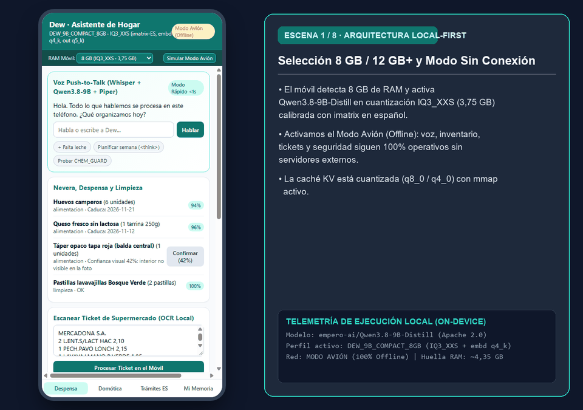

# Dew — Asistente Doméstico Personal Local-First (España)

**Dew** es un asistente doméstico inteligente diseñado para ejecutarse de forma **100% local en teléfonos móviles** (Android e iOS), priorizando la privacidad, la ligereza operativa y el control explícito del usuario.

En lugar de ser un chatbot genérico, **Dew** recuerda el contexto útil del hogar con permiso explícito, gestiona el inventario de nevera, despensa y productos de limpieza, propone cestas de compra presupuestadas, controla la domótica en red local y actúa como copiloto preparador para trámites digitales en España (`Mi Carpeta Ciudadana`, `Cl@ve`, `AEAT` y servicios autonómicos de salud).

---

## Demostración Funcional en Vivo (E2E)



* **Vídeo completo en alta resolución (MP4):** [`docs/demo/dew_demo_funcional.mp4`](./docs/demo/dew_demo_funcional.mp4)
* **Script reproductor/grabador automatizado (CDP + Chrome Headless):** [`scripts/record_demo_video.py`](./scripts/record_demo_video.py)

---

## Arquitectura del Proyecto

* **[`ARQUITECTURA_DEW.md`](./ARQUITECTURA_DEW.md)**: Especificación completa de producto, arquitectura hexagonal *local-first*, flujos de voz, integraciones en España y modelo de seguridad.
* **[`model_pipeline/`](./model_pipeline/)**: Pipeline de calibración (`llama-imatrix` en español doméstico), gramáticas formales (`GBNF`), validador de esquemas y empaquetado de las dos variantes móviles de [`empero-ai/Qwen3.8-9B-Distill`](https://huggingface.co/empero-ai/Qwen3.8-9B-Distill) (Apache 2.0):
  * **Edición Compacta (8 GB RAM):** `IQ3_XXS` con matriz de importancia en español y tensores de entrada/salida protegidos (`q4_k`/`q5_k`, ~3,75 GB).
  * **Edición Pro (12 GB+ RAM):** `Q4_K_M` con matriz de importancia en español (~5,3 GB).
  * **Control dinámico de `<think>`:** Inyección de `<think>\n</think>` para respuestas de voz en `< 1 s` y apertura de `<think>` para planificación semanal de menús y presupuestos.
* **[`dew_core/`](./dew_core/)**: Núcleo determinista de negocio, persistencia local cifrada (SQLite/SQLCipher), gestor de memoria con consentimiento (ARCO/portabilidad JSON), inventario con incertidumbre, guardarraíl químico (`CHEM_GUARD`), conector domótico local (Home Assistant LAN) y preparador de trámites españoles.
* **[`android_app/`](./android_app/)**: Módulos nativos en Kotlin para Android (`HardwareProfiler`, `SequentialMemoryManager`, bridge JNI hacia `llama.cpp` y `sherpa-onnx`).

---

## Inicio Rápido

### 1. Ejecutar el pipeline de calibración y empaquetado del modelo 9B
```powershell
python model_pipeline/calibrate_and_package.py
python model_pipeline/evaluate_quantized_models.py
```

### 2. Ejecutar las pruebas de integración del núcleo (`dew_core`)
```powershell
python -m unittest discover -s tests -v
```

---

## Seguridad, Contribución y Licencia

* **Seguridad y Privacidad:** Consulta [SECURITY.md](./SECURITY.md) para reportar vulnerabilidades de forma privada.
* **Contribuciones:** Revisa [CONTRIBUTING.md](./CONTRIBUTING.md) antes de abrir un Pull Request.
* **Licencia:** Distribuido bajo licencia **[Apache-2.0](./LICENSE)** por **[@CeuTryharder](https://github.com/CeuTryharder)**. Los modelos y runtimes locales incluidos/referenciados emplean licencias permisivas (`Apache-2.0` y `MIT`).
